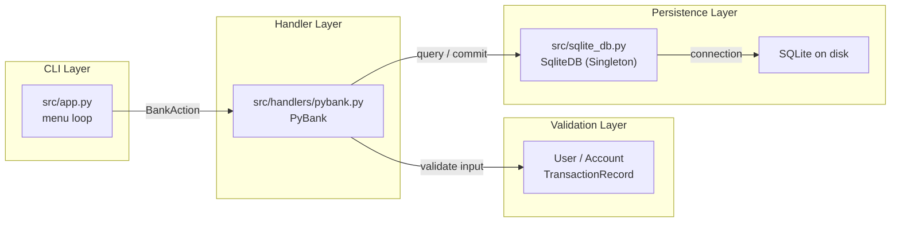

# PyBank

[](https://www.python.org/)
[](https://codecov.io/github/anupmika/pybank)
[](LICENSE)

A terminal-based Python banking system demonstrating clean architecture,
object-oriented design, `pydantic` data validation, SQLite persistence,
transaction management, and CLI error handling. PyBank lets a bank teller
register customers, open accounts, and perform deposits / withdrawals while
printing formatted passbook statements.

> **Status:** Early-stage educational project. See the
> [Architecture Guide](docs/architecture.md) and [User Guide](docs/user-guide.md)
> for full details.

---

## Table of Contents

| Section |
| --- |
| [Features](#features) |
| [Project Structure](#project-structure) |
| [Getting Started](#getting-started) |
| [Usage](#usage) |
| [Data Model](#data-model) |
| [Documentation](#documentation) |
| [Development](#development) |
| [License](#license) |

---

## Features

- **CLI menu-driven interface** built with Python's `match` statement.
- **Account registration** capturing Aadhaar, name, email, phone, age, etc.
- **Deposit & withdrawal** transactions with real-time balance updates.
- **Balance inquiry** and **full account profile** views.
- **Passbook history** rendering a columnar statement with running balance.
- **Pydantic v2 validation** at the trust boundary — malformed data is rejected
  before it ever touches the database.
- **SQLite storage** with WAL journaling and `IF NOT EXISTS` schema bootstrapping.
- **Singleton connection** manager via a reusable metaclass.
- **Transactional integrity** — commits on success, rollback on validation or
  database errors.

---

## Project Structure

```text
pybank/
├── main.py              # Application entry point
├── pyproject.toml       # Project metadata & dependencies (uv)
├── justfile             # Task recipes (sync, clean)
├── README.md
├── LICENSE              # Apache-2.0
├── .gitignore
├── db/                  # SQLite database (ignored)
├── docs/                # Documentation with Mermaid diagrams
│   ├── architecture.md
│   ├── components.md
│   └── user-guide.md
├── src/
│   ├── app.py           # CLI loop / BankAction router
│   ├── const.py         # DB path & menu text constants
│   ├── enums.py         # BankAction enum
│   ├── sqlite_db.py     # Singleton SQLite connection + schema
│   ├── validators/
│   │   └── models.py    # Pydantic User, Account, TransactionRecord
│   ├── handlers/
│   │   └── pybank.py    # Core banking operations
│   ├── helpers/
│   │   └── design.py    # SingletonMeta metaclass
│   └── utils/
│       └── cli_utils.py # colorama colored printer
└── tests/               # Test suite (pytest)
```

### High-Level Data Flow



---

## Getting Started

### Prerequisites

- [Python](https://www.python.org/) 3.12+ (project targets `>=3.14`)
- [uv](https://docs.astral.sh/uv/) (recommended) or `pip`

### Installation

Using `uv` (recommended):

```bash
uv sync --no-cache
```

Using `pip`:

```bash
python -m pip install .
```

> The `db/` directory is created automatically on first run — no manual
> database setup required.

---

## Usage

Run the application:

```bash
python main.py
```

You will see the main menu:

```text
----------------------
|       PyBank       |
----------------------
| 1 |  Open Account  |
----------------------
| 2 | Deposite Money |
----------------------
| 3 | Withdraw Money |
----------------------
| 4 |  View Balance  |
----------------------
| 5 |  View History  |
----------------------
| 6 | Close  Account |
----------------------
| 7 | View   Account |
----------------------
| 8 |   Close  App   |
----------------------
```

Enter the number of the action you want to perform and follow the prompts.

Full step-by-step walkthroughs are in the [User Guide](docs/user-guide.md).

---

## Data Model

PyBank stores data in two related SQLite tables:

### `users`

| Column            | Type    | Constraints         |
|-------------------|---------|---------------------|
| `id`              | INTEGER | PK (autoincrement)  |
| `aadhar_num`      | TEXT    | UNIQUE NOT NULL     |
| `name`            | TEXT    | NOT NULL            |
| `email`           | TEXT    | nullable            |
| `phone`           | TEXT    | NOT NULL            |
| `age`             | INTEGER | NOT NULL            |
| `father_name`     | TEXT    | NOT NULL            |
| `address`         | TEXT    | nullable            |
| `city`            | TEXT    | NOT NULL            |
| `initial_balance` | REAL    | NOT NULL            |
| `created_at`      | TEXT    | NOT NULL (ISO)      |

### `accounts`

| Column          | Type    | Constraints                     |
|-----------------|---------|---------------------------------|
| `account_num`   | INTEGER | UNIQUE NOT NULL, `500000` + id  |
| `user_id`       | INTEGER | FK → `users(id)` NOT NULL       |
| `account_type`  | TEXT    | default `'savings'`             |
| `balance`       | REAL    | default `0`                     |
| `currency`      | TEXT    | default `'INR'`                 |
| `is_active`     | INTEGER | default `1` (0 = inactive)      |
| `created_at`    | TEXT    | NOT NULL (ISO)                  |

> Each `User` record is parent to exactly one `Account` via the `user_id`
> foreign key. Account numbers are derived as `500000 + user_id`.

See the [Component Reference](docs/components.md) for Pydantic validation rules
and field aliases.

---

## Documentation

| Document | Description |
| --- | --- |
| [Architecture Guide](docs/architecture.md) | System overview, layers, design patterns, and sequence diagrams. |
| [Component Reference](docs/components.md) | Module-by-module breakdown of classes, functions, and data models. |
| [User Guide](docs/user-guide.md) | End-to-end walkthrough of every menu option. |

---

## Development

### Sync dependencies

```bash
uv sync --no-cache        # or: just sync
```

### Clean caches

```bash
just clean
```

### Run tests (when available)

```bash
python -m pytest tests/
```

---

## License

Licensed under the [Apache License 2.0](LICENSE).
