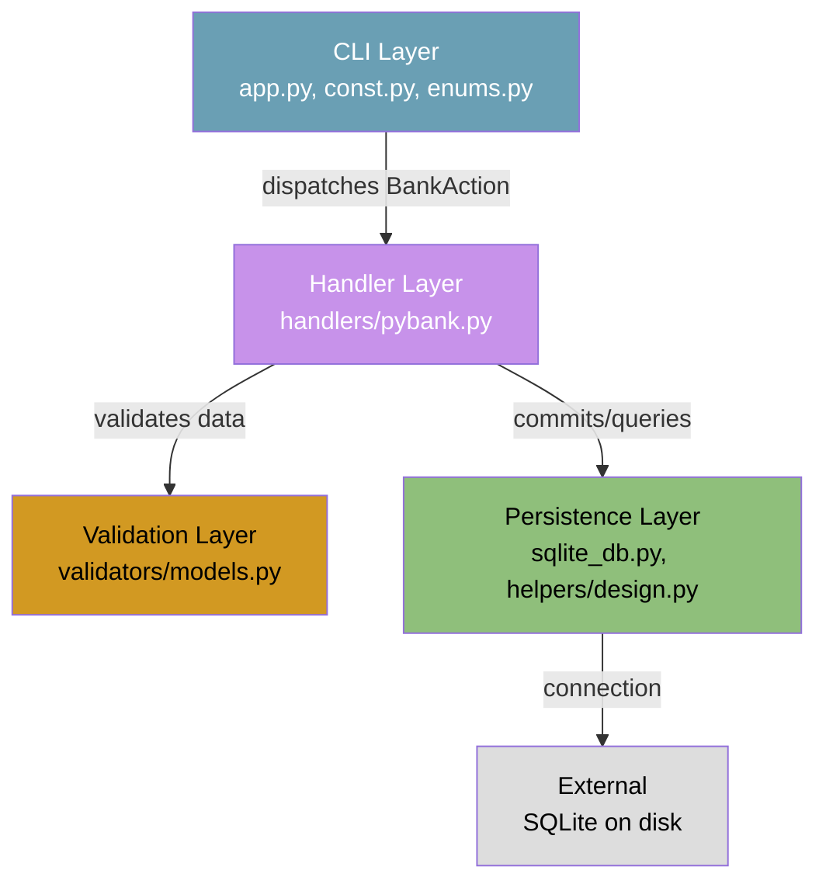
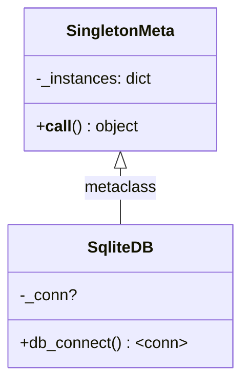
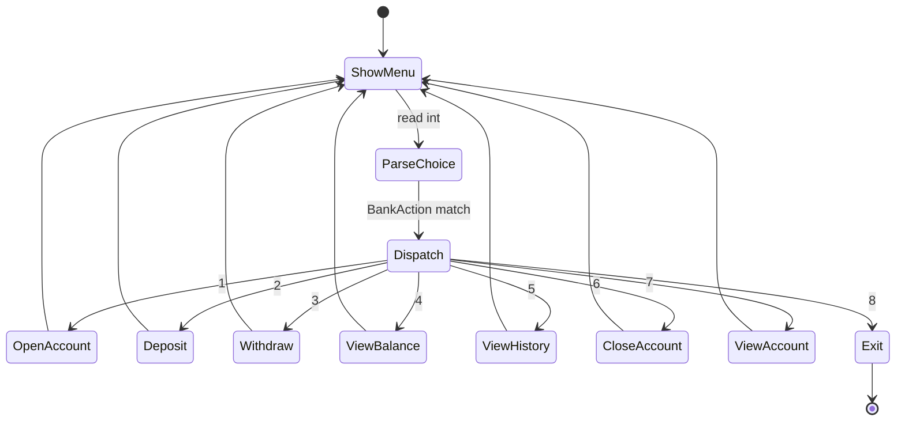
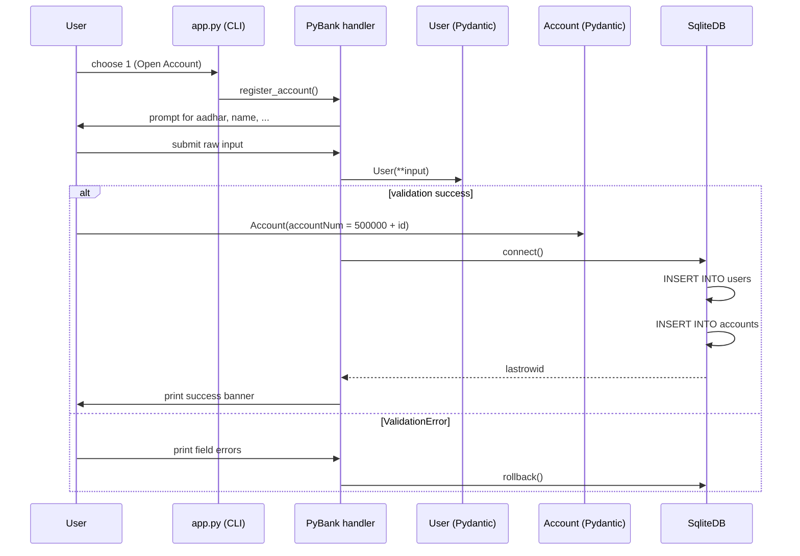
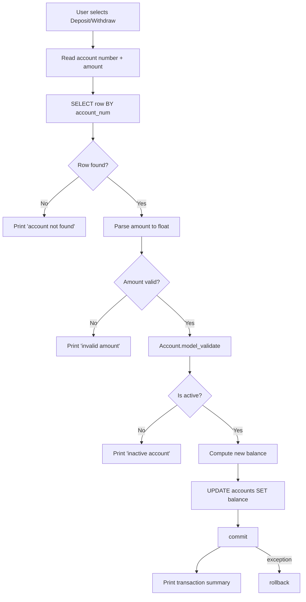
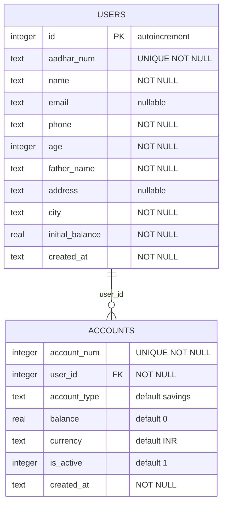
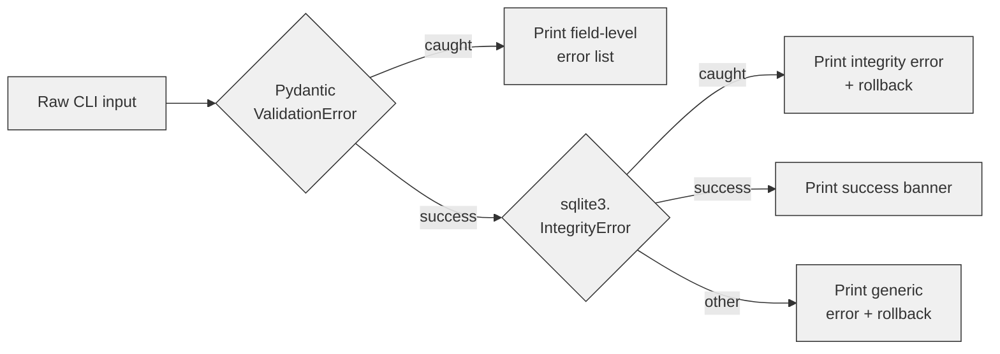

# Architecture Guide

PyBank is a small but well-layered terminal banking application. This document
explains how the system is organized, the design patterns it uses, and how data
and control flow between the layers.

---

## Table of Contents

| Section |
| --- |
| [System Overview](#system-overview) |
| [Layered Architecture](#layered-architecture) |
| [Design Patterns](#design-patterns) |
| [Request Flow (Sequence)](#request-flow-sequence) |
| [Database Schema](#database-schema) |
| [Error Handling Strategy](#error-handling-strategy) |

---

## System Overview

PyBank runs as a single-process CLI application. The user interacts through a
numbered text menu; each selection is mapped to a `BankAction` enum value and
dispatched to the corresponding method on the `PyBank` handler. All persistence
is handled by a Singleton-wrapped SQLite connection.

### Goals

- Demonstrate clean separation of concerns in a compact codebase.
- Show how Pydantic validation guards the database trust boundary.
- Model the classic banking primitives: **register → deposit/withdraw → report**.

---

## Layered Architecture

The codebase is split into four logical layers. Each layer depends only on the
layers below it (dependency rule flows downward).

### Layer Descriptions

| Layer | Files | Responsibility |
| --- | --- | --- |
| **CLI** | `app.py`, `const.py`, `enums.py` | Renders the menu, reads the user's choice, and routes to the handler. No business logic. |
| **Handler** | `handlers/pybank.py` | The `PyBank` class orchestrates the banking operations: input collection, validation, SQL execution, and user-facing output. |
| **Validation** | `validators/models.py` | Pydantic models (`User`, `Account`, `TransactionRecord`) that enforce schema rules and field aliases. |
| **Persistence** | `sqlite_db.py`, `helpers/design.py` | Singleton-gated SQLite connection factory plus one-time schema creation. |

---

## Design Patterns

### 1. Singleton — `SqliteDB`

A single database connection (with WAL journaling) is shared across the entire
application lifetime. This avoids file-level lock contention and guarantees the
schema is created exactly once.

**Implementation**: `src/helpers/design.py` defines the `SingletonMeta`
metaclass, and `src/sqlite_db.py` applies it to `SqliteDB`.

### 2. Command / Dispatch — `BankAction` enum

The CLI loop maps the user's integer choice to a `BankAction` enum member, then
uses a `match` statement to invoke the corresponding handler. This is a
lightweight variant of the Command pattern — each case is an implicit command.

### 3. Data Transfer Object — Pydantic Models

`User`, `Account`, and `TransactionRecord` are validated DTOs. They decouple the
raw user input (which uses camelCase aliases like `fatherName`, `accountNum`)
from the snake_case database columns. Pydantic also provides `model_dump()` for
parameterised SQL insertion.

---

## Request Flow (Sequence)

### Registration Sequence

The following diagram shows how a new customer account is created end-to-end.

### Transaction Sequence (Deposit / Withdraw)

---

## Database Schema

The full schema is created in `SqliteDB.db_connect()` via
`conn.executescript(...)`. There are currently two tables plus an implicit
`id` primary key on `users`.

---

## Error Handling Strategy

PyBank applies errors at three layers:

| Exception type | Where | Behaviour |
| --- | --- | --- |
| `ValueError` | `app.py` menu parse | Reprints the menu; user re-enters. |
| `pydantic.ValidationError` | handler methods | Lists every invalid field; rolls back the DB transaction. |
| `sqlite3.IntegrityError` | `register_account` | Reports the duplicate Aadhaar; rollback. |
| generic `Exception` | all I/O methods | Prints the error and rolls back if a transaction is open. |
