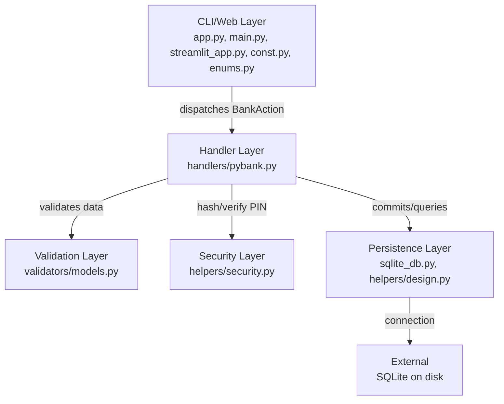
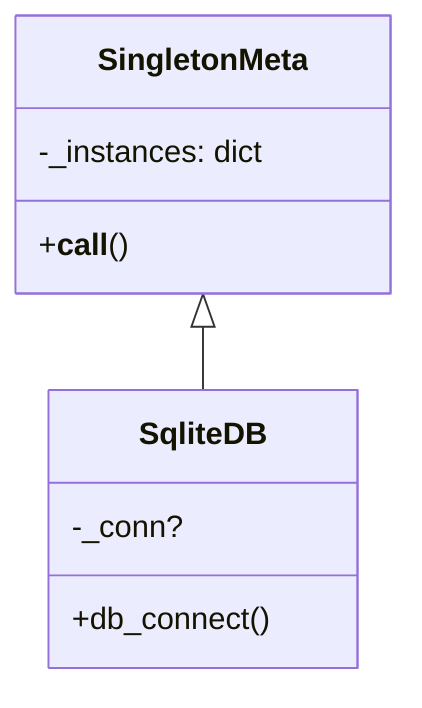
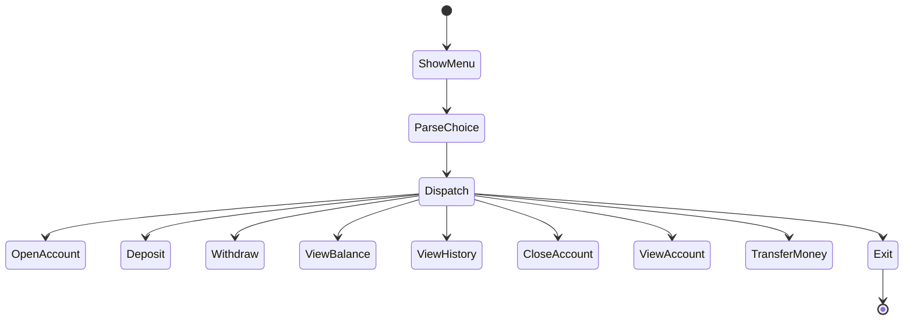
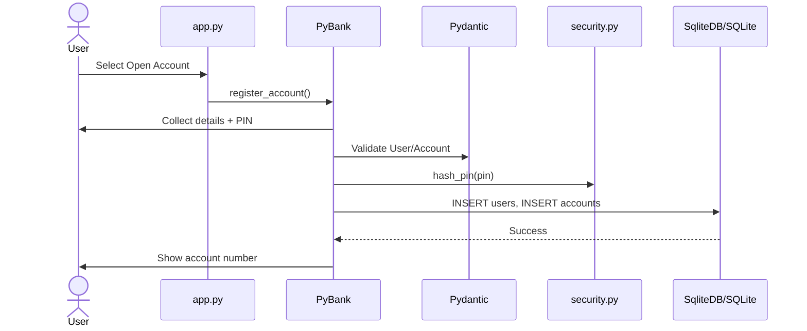
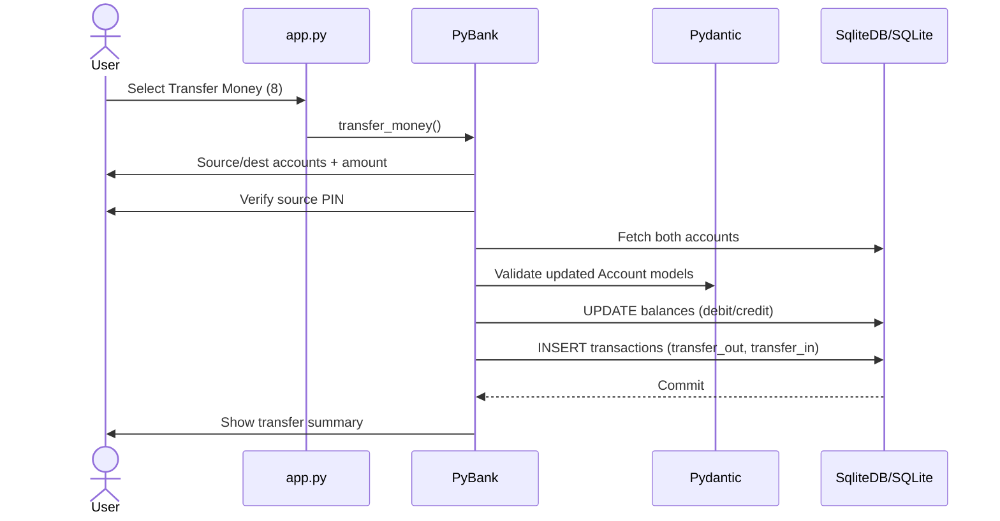

# Architecture Guide

PyBank is a dual-interface banking application (CLI and Streamlit web UI). This document explains system organization, design patterns, and data/control flow.

## Table of Contents

- [System Overview](#system-overview)
- [Layered Architecture](#layered-architecture)
- [Design Patterns](#design-patterns)
- [Request Flow (Sequence)](#request-flow-sequence)
- [Database Schema](#database-schema)
- [Error Handling Strategy](#error-handling-strategy)

## System Overview

PyBank runs as a single-process CLI and Streamlit app. Users interact via numbered menus (CLI) or sidebar (web UI). Each selection maps to `BankAction` and dispatches to `PyBank`. Persistence uses a Singleton SQLite connection with PIN-based authentication (PBKDF2-HMAC-SHA256).

### Goals

- Clean separation of concerns
- Pydantic validation at trust boundary
- Secure PIN hashing/verification
- Full operations: register → deposit/withdraw/transfer → history → manage accounts
- Shared core logic across CLI and web

## Layered Architecture

### Layer Descriptions

| Layer | Files | Responsibility |
| --- | --- | --- |
| CLI/Web | `app.py`, `main.py`, `streamlit_app.py`, `const.py`, `enums.py` | Render menus, read input, route actions. No business logic. |
| Handler | `handlers/pybank.py` | Orchestrate operations, input, validation, SQL, PIN verification, output. |
| Validation | `validators/models.py` | Pydantic models (`User`, `Account`, `TransactionRecord`) with aliases. |
| Security | `helpers/security.py` | PIN hashing/verification with PBKDF2-HMAC-SHA256 and salts. |
| Persistence | `sqlite_db.py`, `helpers/design.py` | Singleton DB connection, schema/migrations, WAL mode. |

## Design Patterns

### 1. Singleton - `SqliteDB`

Single shared SQLite connection with WAL journaling; schema created once.

### 2. Command/Dispatch - `BankAction`

Enum maps menu choices to operations; `match` routes in CLI.

### 3. DTOs with Pydantic

Models validate and normalize data between UI/input and DB.

## Request Flow (Sequence)

### Registration Sequence

### Transfer Money Sequence

## Database Schema

Three tables: `users`, `accounts`, `transactions`. Account numbers derived as `500000 + user_id`. Foreign keys link users-accounts and accounts-transactions.

## Error Handling Strategy

- Pydantic `ValidationError` caught with field-level messages
- SQLite `IntegrityError` for duplicates (e.g., Aadhaar)
- PIN attempts limited to 3; lockout after failures
- Transactions rollback on errors; commits only on success
- Graceful messages for missing/invalid/inactive accounts
