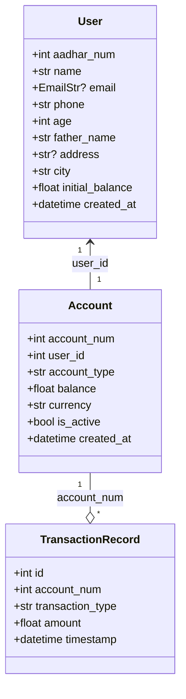
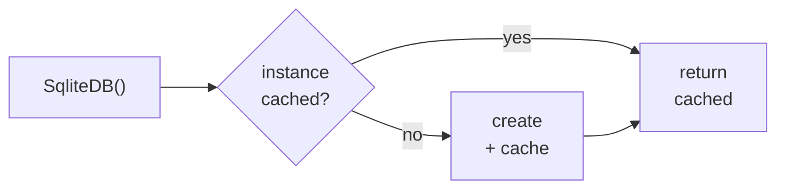
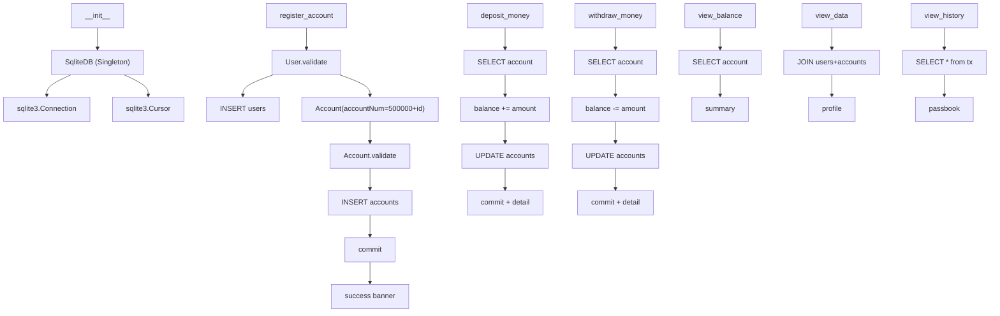

# Component Reference

This document is a module-by-module reference for every class, function, and
data model in PyBank. Use it as the single source of truth for the public API
of each component.

---

## Table of Contents

| Section |
| --- |
| [Entry Point](#entry-point) |
| [Constants](#constants) |
| [Enums](#enums) |
| [Validation Models](#validation-models) |
| [Persistence](#persistence) |
| [Design Helpers](#design-helpers) |
| [CLI Helpers](#cli-helpers) |
| [Banking Handler](#banking-handler) |

---

## Entry Point

### `main.py`

```python
from src.app import bank

if __name__ == "__main__":
    bank()
```

Thin bootstrap that calls the application loop. Run with:

```bash
python main.py
```

---

## Constants

### `src/const.py`

| Symbol | Type | Description |
| --- | --- | --- |
| `DB_NAME` | `str` | `"pybank.db"` — the SQLite file name. |
| `DB_PATH` | `str` | `"db/pybank.db"` — relative path to the database file. The `db/` directory is created on demand by `SqliteDB.db_connect()`. |
| `BANK_MENU` | `str` | The multi-line ASCII menu banner printed on every loop iteration (choices 1–8). |

### Constants (`src/handlers/pybank.py`)

| Symbol | Type | Description |
| --- | --- | --- |
| `MAX_PIN_ATTEMPTS` | `int` | Maximum PIN verification attempts before access is denied (`3`). |
| `ENTER_ACCOUNT_PROMPT` | `str` | The input prompt reused for account number lookup (`'Enter Account Number: '`). |
| `ACCOUNT_NOT_FOUND` | `str` | Error message printed when an account row is missing (`'❌ Error: Account number not found.'`). |
| `ACCOUNT_NOT_FOUND_RECORDS` | `str` | Error message printed when an account row is missing in PIN verification (`'❌ Error: Account number not found in our records.'`). |
| `INVALID_AMOUNT` | `str` | Error message printed when a non-numeric amount is entered (`'❌ Error: Invalid amount entered. Please type a valid numeric number.'`). |

---

## Enums

### `src/enums.py`

```python
class BankAction(Enum):
    OPEN_ACCOUNT = 1
    DEPOSIT_MONEY = 2
    WITHDRAW_MONEY = 3
    VIEW_BALANCE = 4
    VIEW_HISTORY = 5
    CLOSE_ACCOUNT = 6  # stub — not yet implemented
    VIEW_ACCOUNT = 7
    CLOSE_APP = 8
```

The enum values mirror the number the user types at the menu. `app.py` wraps
the raw `int` in `BankAction(...)` so an invalid number raises `ValueError`
and the menu simply reprints.

---

## Validation Models

### `src/validators/models.py`

Three Pydantic v2 models provide the trust boundary between raw user input
and the database.



#### `User`

| Field | Alias | Type | Constraints |
| --- | --- | --- | --- |
| `aadhar_num` | — | `str` | 12 digits (`^\d{12}$`) |
| `name` | — | `str` | 3–50 chars |
| `email` | — | `EmailStr \| None` | optional, valid email |
| `phone` | — | `str` | 10–15 chars |
| `age` | — | `int` | 1–125 |
| `father_name` | `fatherName` | `str` | 3–50 chars |
| `address` | — | `str \| None` | ≤ 200 chars |
| `city` | — | `str` | 2–50 chars |
| `initial_balance` | `initialBal` | `float` | ≥ 0 |
| `created_at` | `createdAt` | `datetime` | default `datetime.now()` |

`model_config = ConfigDict(populate_by_name=True)` allows construction from
either snake_case keys or the camelCase aliases.

#### `Account`

| Field | Alias | Type | Constraints |
| --- | --- | --- | --- |
| `account_num` | `accountNum` | `int` | ≥ 1 |
| `user_id` | `userId` | `int` | ≥ 1 |
| `account_type` | `accountType` | `str` | default `"savings"` |
| `balance` | — | `float` | ≥ 0 |
| `currency` | — | `str` | 3 chars, default `"INR"` |
| `is_active` | `isActive` | `bool` | default `True` |
| `created_at` | `createdAt` | `datetime` | default `datetime.now()` |

#### `TransactionRecord`

| Field | Type | Constraints |
| --- | --- | --- |
| `id` | `int` | — |
| `account_num` | `int` | — |
| `transaction_type` | `str` | — |
| `amount` | `float` | ≥ 0 |
| `timestamp` | `datetime` | — |

---

## Persistence

### `src/sqlite_db.py`

```python
class SqliteDB(metaclass=SingletonMeta):
    def db_connect(self) -> sqlite3.Connection
```

**Responsibility**: Return a configured SQLite connection. On first call,
ensures the `db/` directory exists, enables WAL journaling, and creates the
`users` and `accounts` tables if they do not yet exist.

#### `db_connect()`

| Step | Detail |
| --- | --- |
| `os.makedirs` | Creates `db/` (exist_ok=True). |
| `sqlite3.connect(DB_PATH)` | Opens the connection. |
| `PRAGMA journal_mode=WAL` | Improves concurrent read performance. |
| `executescript(...)` | `CREATE TABLE IF NOT EXISTS` for `users` and `accounts`. |
| `commit()` | Persists schema. |
| returns | the live `sqlite3.Connection`. |

---

## Design Helpers

### `src/helpers/design.py`

```python
class SingletonMeta(type):
    _instances: dict = {}
    def __call__(cls, *args, **kwargs) -> object
```

A metaclass that caches the first instance of any class using it. Subsequent
calls to `cls()` return the cached object, so `SqliteDB` is instantiated as a
single shared connection.



---

## CLI Helpers

### `src/utils/cli_utils.py`

```python
from colorama import Fore, Style, init
init(autoreset=True)

def colored(text: str, color_name: str) -> None
```

Wraps a string in the ANSI escape code for the requested color and prints it.
The color name is normalized to uppercase and looked up on `colorama.Fore`.
If the name is unknown, the text is still printed without color.

> Note: `colored()` prints rather than returns the string.

---

## Banking Handler

### `src/handlers/pybank.py`

```python
class PyBank:
    def __init__(self) -> None
```

The central handler. Instantiates `SqliteDB` (Singleton), stores the connection
and cursor, then dispatches the eight `BankAction` operations.

#### Constructor

| Attribute | Source |
| --- | --- |
| `self.connect` | `SqliteDB().db_connect()` |
| `self.cursor` | `self.connect.cursor()` |

#### Public Methods

| Method | BankAction | Description |
| --- | --- | --- |
| `register_account()` | `OPEN_ACCOUNT` (1) | Collects user info, validates via `User`, inserts `users` + `accounts` rows. |
| `deposit_money()` | `DEPOSIT_MONEY` (2) | Reads account + amount, validates, updates balance. |
| `withdraw_money()` | `WITHDRAW_MONEY` (3) | Reads account + amount, validates, updates balance. |
| `view_balance()` | `VIEW_BALANCE` (4) | Queries one account, prints a compact summary. |
| `view_data()` | `VIEW_ACCOUNT` (7) | Joins `users` + `accounts`, prints a full customer profile. |
| `view_history()` | `VIEW_HISTORY` (5) | Renders a columnar passbook with running balance. |
| *(stub)* | `CLOSE_ACCOUNT` (6) | Currently a `pass` — reserved for future implementation. |

#### Internal Flow Summary



#### Error Handling Matrix

| Method | Caught exceptions | Action on failure |
| --- | --- | --- |
| `register_account` | `ValidationError` | print field errors; `rollback()` |
| `register_account` | `sqlite3.IntegrityError` | print duplicate-Aadhaar message; `rollback()` |
| `deposit_money` | `ValidationError` | print message; `rollback()` |
| `deposit_money` | `Exception` | print generic error; `rollback()` |
| `withdraw_money` | `ValidationError` | print message; `rollback()` |
| `withdraw_money` | `Exception` | print generic error; `rollback()` |
| `view_balance` | `ValidationError` | print corruption message |
| `view_balance` | `Exception` | print generic error |
| `view_data` | `ValidationError` | print corruption message |
| `view_data` | `Exception` | print generic error |
| `view_history` | `ValidationError` | print parse-failure message |
| `view_history` | `Exception` | print generic error |
