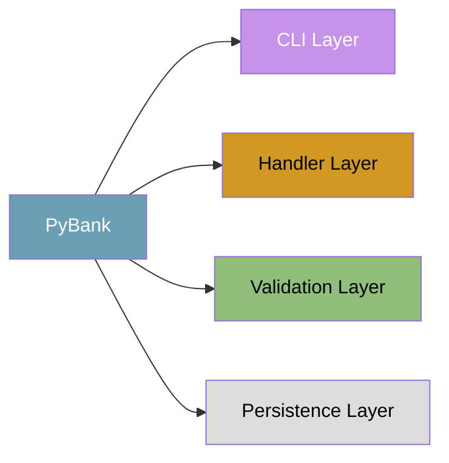
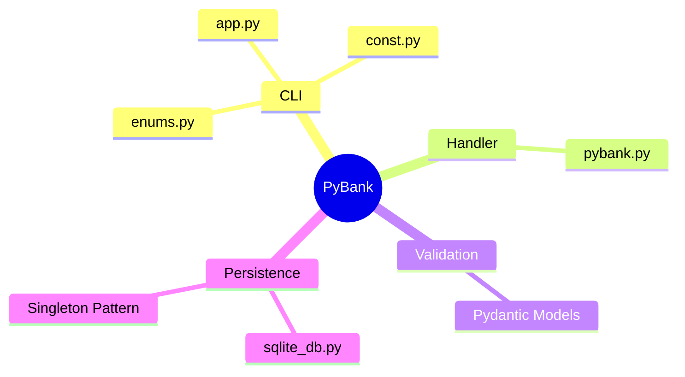
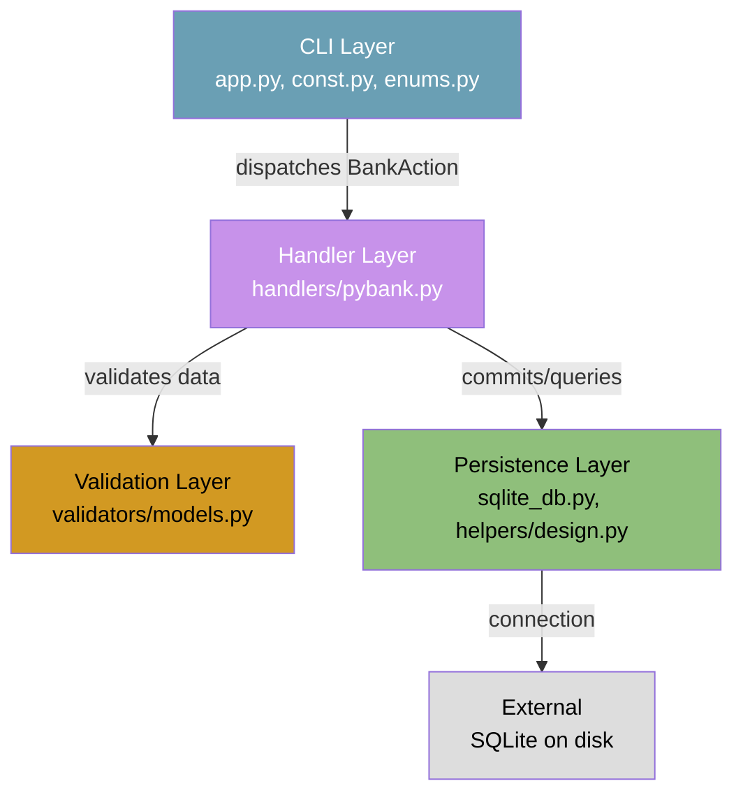
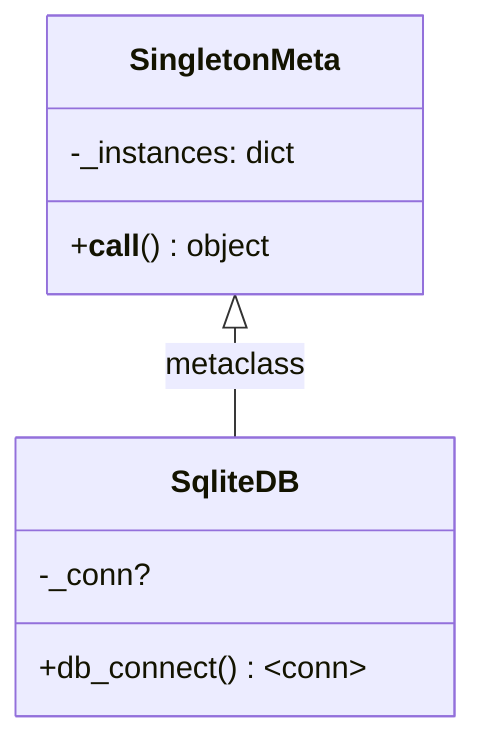
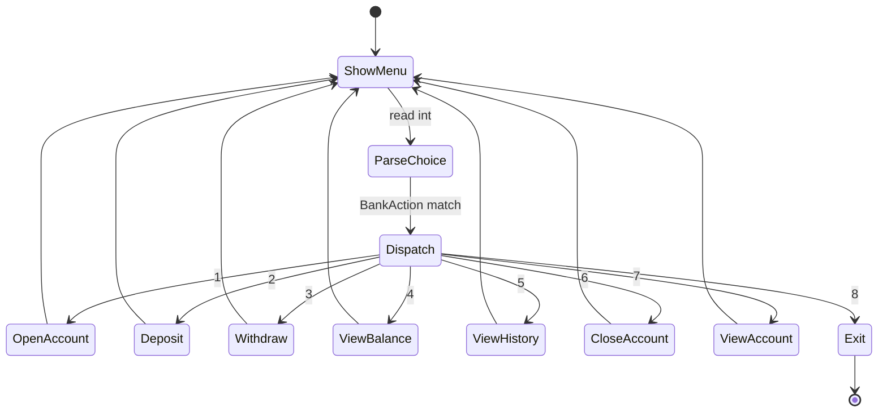
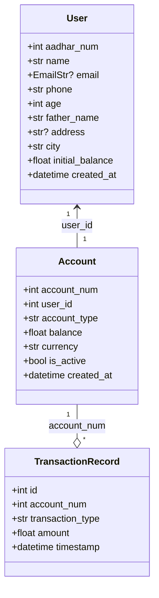
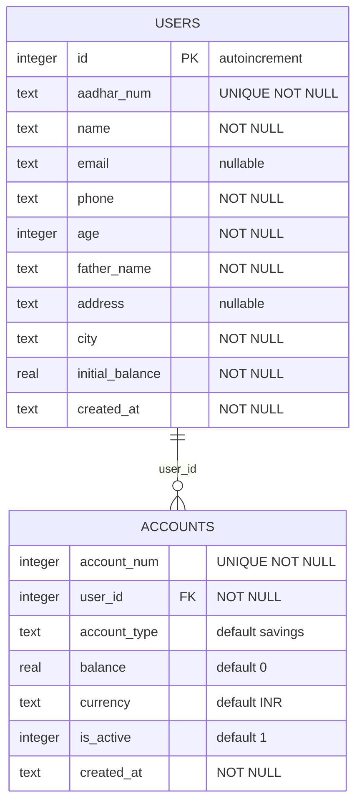
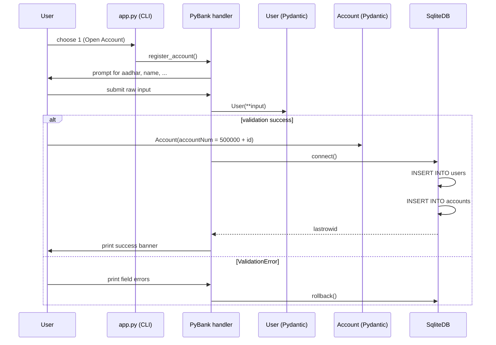
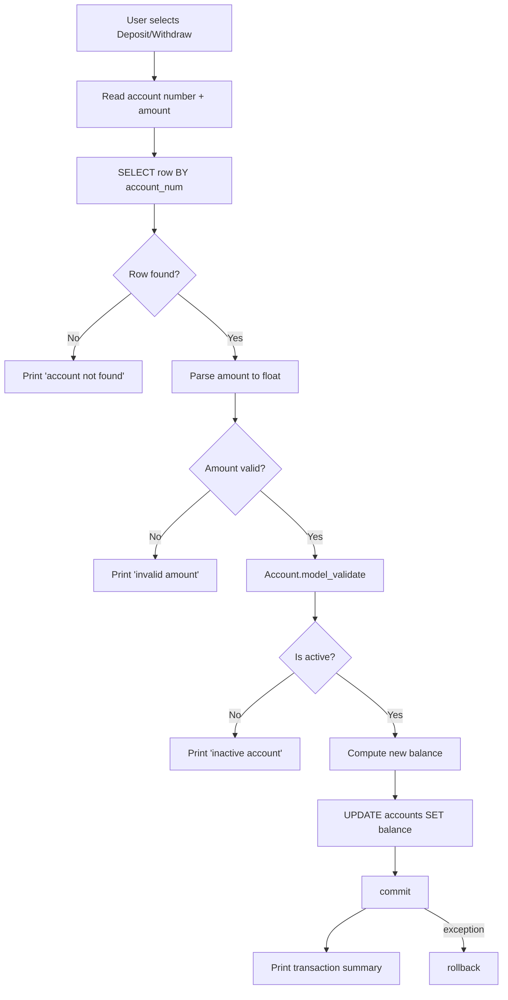
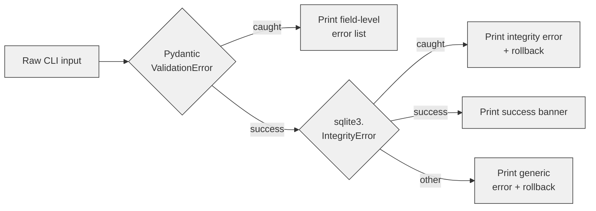

# PyBank — Presentation

> A terminal-based banking system built with clean architecture, Pydantic validation, and SQLite persistence.

---

## Slide 1: Introduction

- **PyBank** is a CLI banking application that demonstrates clean separation of concerns in a compact Python codebase.
- It models classic banking primitives: **register → deposit/withdraw → report**.
- Uses **Pydantic v2** for validation, **SQLite** for persistence, and **Mermaid** for architecture documentation.

---

## Slide 2: System Overview

- Single-process terminal application
- Numbered text menu mapped to `BankAction` enum
- Singleton-wrapped SQLite connection
- WAL journaling enabled for concurrency

---

## Slide 3: Layered Architecture

---

## Slide 4: Design Patterns

### 1. Singleton — `SqliteDB`

### 2. Command / Dispatch — `BankAction` enum

---

## Slide 5: Data Models

---

## Slide 6: Database Schema

---

## Slide 7: Request Flow — Registration

---

## Slide 8: Request Flow — Deposit / Withdraw

---

## Slide 9: Error Handling Strategy

---

## Slide 10: Key Takeaways

- **Clean Architecture**: Four layers with strict dependency rules
- **Validation at the Boundary**: Pydantic guards all database writes
- **Shared Connection**: Singleton pattern prevents file lock contention
- **Atomic Transactions**: Every mutating operation commits or rolls back
- **Extensible**: Command dispatch via enum makes adding new operations trivial
