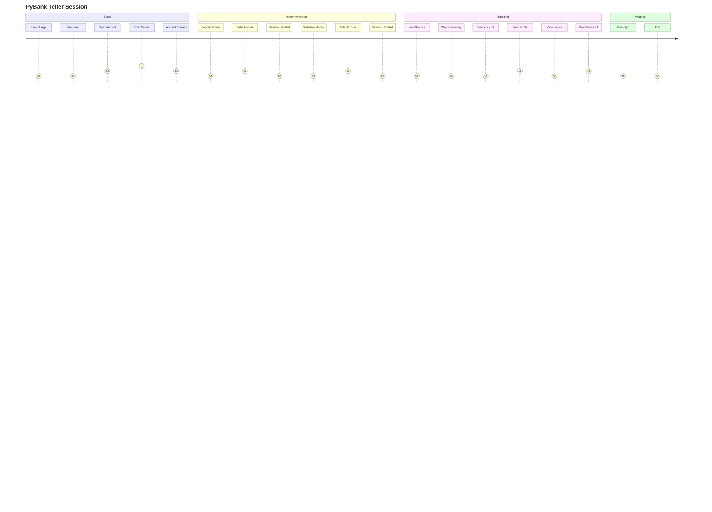

# User Guide

This guide walks through every menu option in PyBank, showing the expected
input and the output the application produces.

---

## Table of Contents

| Section |
| --- |
| [Starting PyBank](#starting-pybank) |
| [1. Open Account](#1-open-account) |
| [2. Deposit Money](#2-deposit-money) |
| [3. Withdraw Money](#3-withdraw-money) |
| [4. View Balance](#4-view-balance) |
| [5. View History](#5-view-history) |
| [6. Close Account](#6-close-account) |
| [7. View Account](#7-view-account) |
| [8. Close App](#8-close-app) |

---

## Starting PyBank

```bash
python main.py
```

You will see:

```text
----------------------
|       PyBank       |
----------------------
| 1 |  Open Account  |
----------------------
| 2 | Deposite Money |
----------------------
| 3 | Withdraw Money |
----------------------
| 4 |  View Balance  |
----------------------
| 5 |  View History  |
----------------------
| 6 | Close  Account |
----------------------
| 7 | View   Account |
----------------------
| 8 |   Close  App   |
----------------------
```

Type the number of your chosen action and press **Enter**.

---

## 1. Open Account

Collects the customer's personal information and opens a new account. Every
field is validated by the `User` Pydantic model before anything is written to
the database.

```text
Please Enter Choice: 1

Enter 12-digit Aadhar Number (no dashes): 123456789012
Enter Full Name: Alice Sharma
Enter Email (Optional, press Enter to skip): alice@example.com
Enter Phone Number: 9876543210
Enter Age: 30
Enter Father's Name: Ramesh Sharma
Enter Address (Optional, press Enter to skip): 12 Main Road
Enter City: Mumbai
Enter Initial Balance: 15000

==============================================
🎉 REGISTRATION SUCCESSFUL!
Dear Alice Sharma, your account is active.
Your system assigned Account Number is: 500001
Opening Balance: 15000.0 INR
==============================================
```

> If validation fails, PyBank prints each offending field and rolls back the
> transaction so no partial data is stored.

---

## 2. Deposit Money

Adds funds to an existing account. The account number is looked up, the amount
is parsed as a float, and the balance is updated atomically.

```text
Please Enter Choice: 2

Enter Account Number: 500001
Enter Amount to Deposit: 5000

==============================================
💰 DEPOSIT TRANSACTION SUCCESSFUL
Account Number : 500001
Deposited      : +5,000.00 INR
Updated Balance: 20,000.00 INR
==============================================
```

---

## 3. Withdraw Money

Deducts funds from an existing account. The balance is checked for
non-negativity by the `Account` model before the update is committed.

```text
Please Enter Choice: 3

Enter Account Number: 500001
Enter Amount to Withdraw: 2000

==============================================
💰 WITHDRAW TRANSACTION SUCCESSFUL
Account Number : 500001
Withdraw : -2,000.00 INR
Updated Balance: 18,000.00 INR
==============================================
```

---

## 4. View Balance

Shows a compact summary of a single account. No personal data is displayed —
only account-level metrics.

```text
Please Enter Choice: 4

Enter your Account Number: 500001

==============================================
📊 ACCOUNT SUMMARY
Account Number : 500001
Account Type   : Savings
Current Balance: 18,000.00 INR
Status         : 🟢 Active
==============================================
```

---

## 5. View History

Renders a printable passbook statement. The running balance starts from the
`initial_balance` and is adjusted for each transaction in chronological order.

```text
Please Enter Choice: 5

Enter Account Number: 500001

===============================================================================
                         🏦 PYBANK OFFICIAL PASSBOOK STATEMENT                          
 ACCOUNT NUMBER: 500001                   | CURRENCY: INR
===============================================================================
  DATE/TIME         PARTICULARS            | DEPOSIT (+) | WITHDRAW(-) |    BALANCE    
-------------------------------------------------------------------------------
Initial Opening Deposit                    |             |             |      15,000.00
===============================================================================
```

> When no transactions exist, PyBank prints:
>
> ```text
> ℹ️ Passbook statement empty. No recorded transactions found.
> ```

---

## 6. Close Account

Currently a placeholder. This menu option is reserved for future
implementation and does nothing at present.

```text
Please Enter Choice: 6
```

(The menu simply reprints.)

---

## 7. View Account

Displays the full customer profile by joining the `users` and `accounts`
tables on `user_id`.

```text
Please Enter Choice: 7

Enter Account Number to view full profile: 500001

==============================================
👤 CUSTOMER PROFILE & ACCOUNT DETAILS
==============================================
 CUSTOMER DETAILS:
  • Name        : Alice Sharma
  • Father Name : Ramesh Sharma
  • AAdhar Number : 123456789012
  • Age / City  : 30 yrs / Mumbai
  • Phone / Email: 9876543210 / alice@example.com
  • Address     : 12 Main Road

 🏦 ACCOUNT METRICS:
  • Account No. : 500001
  • Type        : Savings
  • Currency    : INR
  • Net Balance : 18,000.00 INR
  • Account Status: 🟢 Active
==============================================
```

---

## 8. Close App

Exits the program cleanly.

```text
Please Enter Choice: 8
Exiting!!!
```

---

## Common Error Messages

| Scenario | Message |
| --- | --- |
| Invalid menu number | *(menu simply reprints)* |
| Account not found | `❌ Error: Account number not found in our records.` |
| Negative / zero amount | `❌ Error: Deposit amount must be greater than zero.` |
| Non-numeric amount | `❌ Error: Invalid amount entered. Please type a valid numeric number.` |
| Inactive account | `❌ Transaction Denied: Cannot withdraw into an inactive account.` |
| Duplicate Aadhaar | `❌ Database Error: This CNIC profile already exists in our system!` |
| Validation failure | `❌ Registration Failed! Correct these issues:` + field list |

---

## Typical Session Flow


