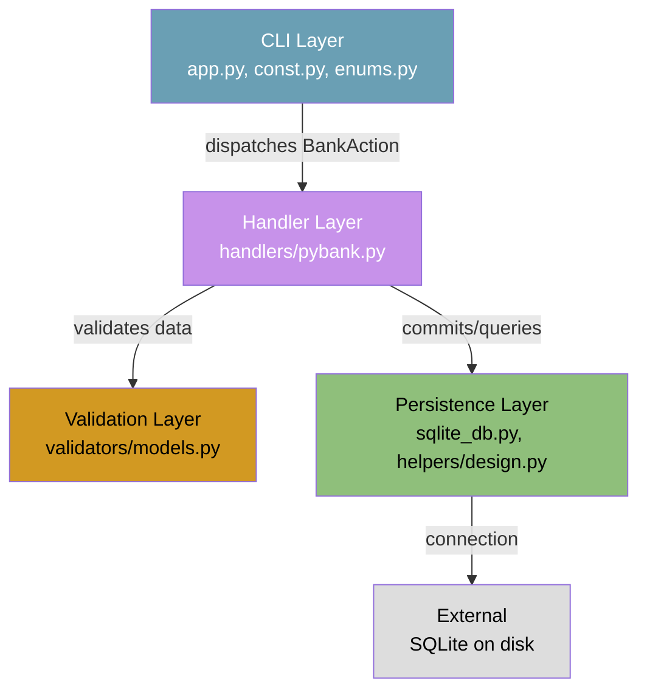
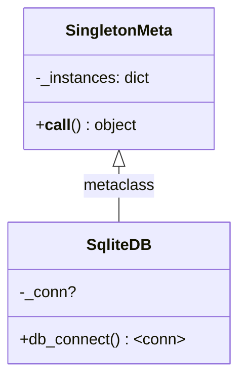
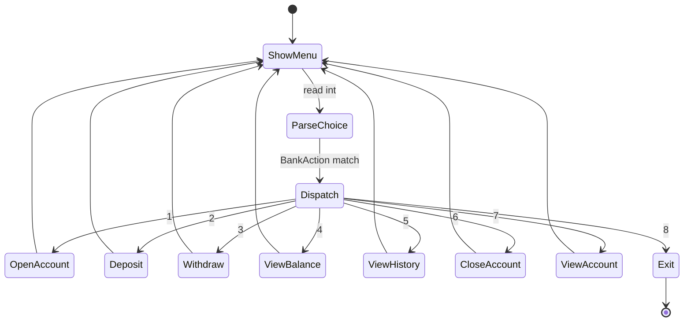
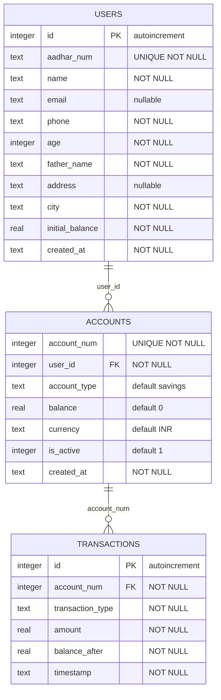
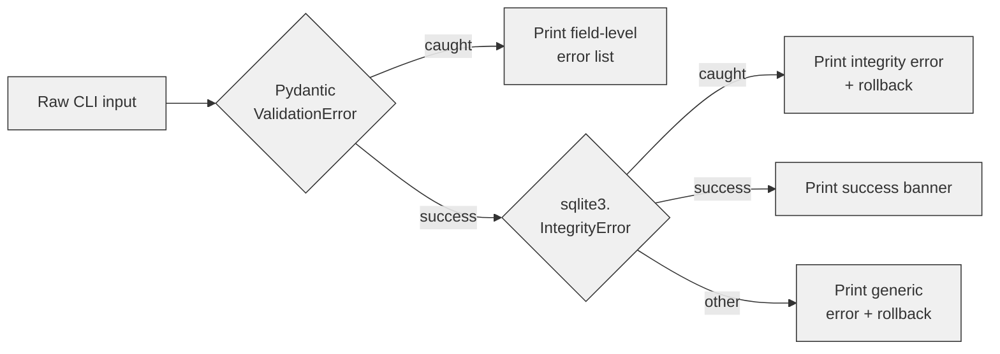
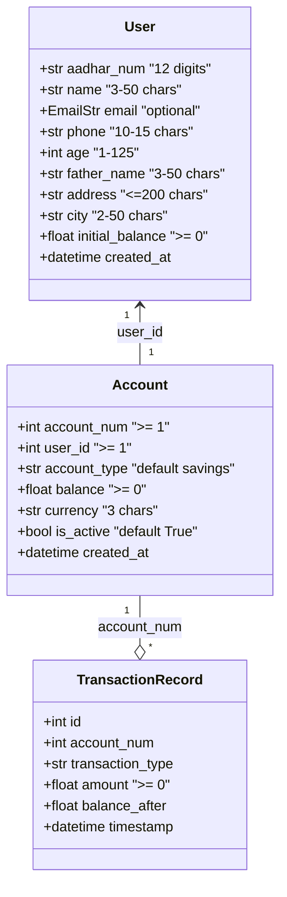
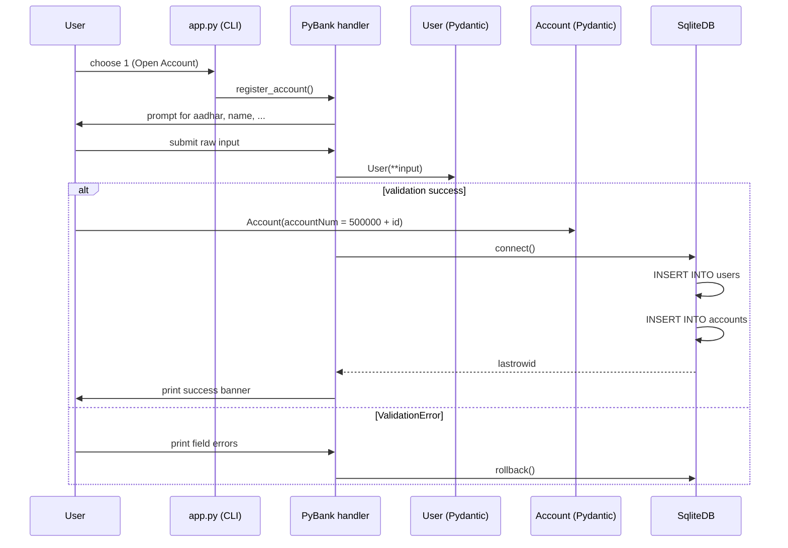
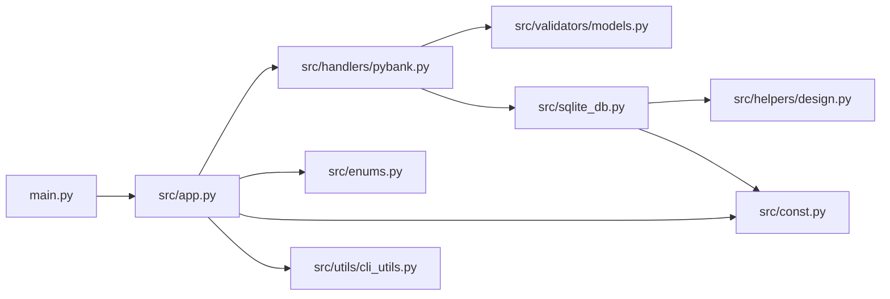

# Mini Project Report on

# PyBank: A Terminal-Based Banking System Using Clean Architecture and Pydantic Validation

Submitted in partial fulfillment of the requirement for award of the degree of

**BACHELOR OF TECHNOLOGY**

in

**Computer Science and Engineering**

**(Data Science)**

by

&lt;Name of the student-1&gt;, &lt;Roll no.&gt;

&lt;Name of the student-2&gt;, &lt;Roll no.&gt;

&lt;Name of the student-3&gt;, &lt;Roll no.&gt;

Under the guidance of

**&lt;Name of the guide&gt;**

# DEPARTMENT OF COMPUTER SCIENCE AND ENGINEERING - DATA SCIENCE

**MEERUT INSTITUTE OF ENGINEERING & TECHNOLOGY,**

**MEERUT**

AFFILIATED TO


# DEC 2023

# Declaration

We hereby declare that the project titled - "PyBank: A Terminal-Based Banking System Using Clean Architecture and Pydantic Validation", which is being submitted as Project/Mini Project in the department of Computer Science and Engineering to Meerut Institute of Engineering and Technology, Meerut (U.P.) is an authentic record of our genuine work done under the guidance of "Name of the Professor" of "Name of the Professor's department", Meerut Institute of Engineering and Technology, Meerut.

Date: Name of Students:

Name of the student (Roll No.)

Place: MIET, Meerut Name of the student (Roll No.) Name of the student (Roll No.)

# Certificate

This is to certify that project/mini project report titled – "PyBank: A Terminal-Based Banking System Using Clean Architecture and Pydantic Validation" submitted by "Name of the student (Roll No.), Name of the student (Roll No.), Name of the student (Roll No.)" has been carried out under the guidance of "Name of the Professor" of "Name of the Professor's department", Meerut Institute of Engineering and Technology, Meerut. This project report is approved for Project/Mini Project in 5th/7th semester in CSE – DATA SCEINCE from Meerut Institute of Engineering and Technology, Meerut.

Supervisor:

Date:

# Acknowledgement

We express our sincere gratitude towards our guide "Name of the Professor" of "Name of the Professor's department", Meerut Institute of Engineering and Technology, Meerut for his/her valuable suggestion, guidance and supervision throughout the project work. We would also like to thank our Head of Department "Name of the Professor" of "name of the Professor's department" for his/her expert advice from time to time. We owe sincere thanks to all the faculty members of our department for their kind encouragement.

| Date:  | Name of the students:          |
| ------ | ------------------------------ |
|        | Name of the student (Roll No.) |
| Place: | Name of the student (Roll No.) |
|        | Name of the student (Roll No.) |

# Abstract

This report presents the design, implementation, and analysis of **PyBank**, a terminal-based banking system developed in Python 3.12+ that demonstrates clean architecture, object-oriented design principles, and robust data validation. PyBank provides core banking functionalities including customer registration, account creation, deposits, withdrawals, balance inquiries, transaction history, and account management through a menu-driven command-line interface.

The system employs a layered architecture comprising four distinct layers: the CLI layer, handler layer, validation layer, and persistence layer. Data integrity is enforced at the trust boundary using Pydantic v2 models, which validate all user inputs before they interact with the database. The persistence layer utilizes SQLite with WAL (Write-Ahead Logging) journaling for concurrent read performance and employs the Singleton design pattern via a custom metaclass to ensure a single shared database connection throughout the application lifecycle.

Transaction management is handled with atomic commits on success and rollbacks on validation or database errors, ensuring data consistency. The project showcases practical applications of design patterns including Singleton, Command Dispatch, and Data Transfer Objects, while adhering to separation of concerns principles. The complete system is built using modern Python features including structural pattern matching (`match` statements), type hints, and Pydantic field aliases for clean API design.

**Table of contents**

| **Description** | **Page No.** |
| --------------- | ------------ |
| Declaration | ii |
| Certificate | iii |
| Acknowledgement | iv |
| Abstract | v |
| Chapter 1- Introduction | 1 |
| Chapter 2- Literature Review and System Analysis | 3 |
| Chapter 3- System Design and Architecture | 5 |
| Chapter 4- Implementation and Results | 9 |
| Appendices | 14 |
| References | 15 |

**Chapter 1-Introduction**

## 1.1 Background

Banking systems have evolved significantly from traditional manual record-keeping to sophisticated digital platforms. However, the fundamental principles of banking—account creation, deposits, withdrawals, and transaction recording—remain constant. Mini projects that implement core banking primitives serve as excellent vehicles for understanding software architecture, data validation, and database design. PyBank is conceived as an educational terminal-based banking system that demonstrates how clean architecture and modern Python features can be combined to build a maintainable and robust application.

## 1.2 Problem Statement

Existing banking solutions, especially in educational contexts, often suffer from monolithic code structures where user interface, business logic, and data access are tightly coupled. This makes testing difficult, validation inconsistent, and maintenance expensive. There is a need for a well-structured banking application that separates concerns, validates data rigorously at system boundaries, and maintains transactional integrity.

## 1.3 Objectives

The primary objectives of this project are:

1. To design and implement a layered banking application with clear separation of concerns.
2. To demonstrate the use of Pydantic v2 for rigorous input validation at the trust boundary.
3. To implement the Singleton design pattern for efficient database connection management.
4. To ensure transactional integrity through atomic commits and rollback mechanisms.
5. To build an intuitive CLI interface using modern Python features.
6. To model real-world banking operations including account registration, deposits, withdrawals, and passbook generation.

## 1.4 Scope

PyBank is designed as a single-user, teller-operated terminal application. It manages customer profiles, savings accounts, and transaction records. The system does not include multi-user authentication, concurrent teller sessions, or internet banking features, keeping the scope focused on demonstrating architectural principles and core banking logic.

## 1.5 Report Organization

This report is organized into four chapters. Chapter 2 reviews related work and analyzes system requirements. Chapter 3 details the system design, layered architecture, and database schema. Chapter 4 presents the implementation details, code walkthrough, and results. Finally, appendices provide supplementary material and references are listed.

**Chapter 2- Literature Review and System Analysis**

## 2.1 Literature Review

### 2.1.1 Banking System Evolution

The history of banking software mirrors the evolution of computing itself. Early banking systems were batch-processing mainframe applications, while modern systems employ microservices, real-time processing, and cloud-native architectures. Despite this evolution, fundamental operations—account management, transaction processing, and ledger maintenance—remain conceptually unchanged.

### 2.1.2 Python in Financial Software

Python has gained significant traction in the financial technology sector due to its readability, extensive library ecosystem, and strong support for data validation through libraries such as Pydantic. The use of Python for educational banking projects allows students to focus on architectural concepts rather than being bogged down by verbose syntax.

### 2.1.3 Data Validation Approaches

Input validation is critical in banking applications to prevent malformed data from corrupting the database. Traditional approaches rely on manual checks scattered throughout the code, leading to inconsistency. Pydantic v2 addresses this by providing declarative validation models that enforce type constraints, format rules, and custom validators at a single trust boundary.

## 2.2 System Analysis

### 2.2.1 Functional Requirements

The system must support the following core functionalities:

- **Account Registration**: Collect and validate customer details (Aadhaar, name, email, phone, age, father's name, address, city, initial balance).
- **Deposit Transaction**: Accept deposits to existing accounts with immediate balance updates.
- **Withdrawal Transaction**: Process withdrawals while ensuring non-negative balances.
- **Balance Inquiry**: Display current account status and balance.
- **Account Profile View**: Show complete customer and account details.
- **Transaction History**: Render a formatted passbook with chronological transaction records.
- **Account Deactivation**: Mark accounts as inactive while preserving transaction history.

### 2.2.2 Non-Functional Requirements

- **Data Integrity**: All database modifications must be atomic; failures must trigger rollbacks.
- **Input Validation**: Reject malformed inputs before database interaction.
- **Performance**: Use WAL journaling for improved read concurrency.
- **Maintainability**: Enforce separation of concerns through layered architecture.
- **Usability**: Provide clear, formatted CLI output with error messages.

### 2.2.3 Technology Stack

| Component | Technology | Purpose |
| --- | --- | --- |
| Language | Python 3.12+ | Core implementation |
| Database | SQLite | Persistent storage |
| Validation | Pydantic v2 | Data validation and serialization |
| CLI Styling | Colorama | Colored terminal output |
| Architecture | Custom metaclass | Singleton pattern implementation |

**Chapter 3- System Design and Architecture**

## 3.1 Layered Architecture

PyBank adopts a strict layered architecture where dependencies flow downward. Each layer communicates only with the layer immediately below it, ensuring loose coupling and high cohesion.



### 3.1.1 CLI Layer

The CLI layer (`src/app.py`, `src/const.py`, `src/enums.py`) is responsible solely for presentation and input capture. It renders the main menu, parses the user's integer choice into a `BankAction` enum, and dispatches the corresponding handler method. No business logic resides in this layer.

### 3.1.2 Handler Layer

The handler layer (`src/handlers/pybank.py`) contains the `PyBank` class, which orchestrates all banking operations. It collects user input, constructs validation models, executes SQL queries, and formats output. This is the only layer that interacts with both the validation and persistence layers.

### 3.1.3 Validation Layer

The validation layer (`src/validators/models.py`) defines three Pydantic models: `User`, `Account`, and `TransactionRecord`. These models enforce schema constraints, type checking, and format validation (e.g., 12-digit Aadhaar, valid email, non-negative balances). They also handle camelCase to snake_case field mapping via aliases.

### 3.1.4 Persistence Layer

The persistence layer (`src/sqlite_db.py`, `src/helpers/design.py`) manages database connectivity. The `SqliteDB` class uses the `SingletonMeta` metaclass to ensure only one connection exists. On first instantiation, it creates the `db/` directory, enables WAL journaling, and bootstraps the schema.

## 3.2 Design Patterns

### 3.2.1 Singleton Pattern

The Singleton pattern is implemented via the `SingletonMeta` metaclass. This ensures that `SqliteDB` is instantiated exactly once, preventing multiple file handles to the same SQLite database and avoiding schema creation race conditions.



### 3.2.2 Command Dispatch Pattern

The `BankAction` enum combined with the `match` statement in `app.py` implements a lightweight Command pattern. Each enum member implicitly represents a command, and the `match` block routes the command to the appropriate handler method.



### 3.2.3 Data Transfer Object (DTO)

Pydantic models serve as validated DTOs, decoupling raw CLI input from database operations. They handle field aliasing (e.g., `fatherName` → `father_name`) and provide `model_dump()` for parameterised SQL queries.

## 3.3 Database Schema

The database consists of three normalized tables that capture the essential entities of a banking system.



### 3.3.1 Users Table

The `users` table stores immutable customer identity information. The `aadhar_num` field is unique, preventing duplicate registrations. The `initial_balance` field captures the opening deposit amount.

### 3.3.2 Accounts Table

The `accounts` table maintains the current state of each account. The `account_num` is derived as `500000 + user_id`, providing a readable account number. The `is_active` flag supports soft deletion, preserving historical data while preventing new transactions on closed accounts.

### 3.3.3 Transactions Table

The `transactions` table records every deposit and withdrawal as an immutable audit trail. The `balance_after` field captures the account balance immediately after the transaction, enabling passbook reconstruction.

## 3.4 Error Handling Strategy

PyBank applies a three-tier error handling approach corresponding to the architectural layers.



| Exception Type | Where Caught | Behaviour |
| --- | --- | --- |
| `ValueError` | `app.py` menu parse | Reprints the menu; user re-enters choice. |
| `pydantic.ValidationError` | Handler methods | Lists every invalid field; rolls back the DB transaction. |
| `sqlite3.IntegrityError` | `register_account` | Reports duplicate Aadhaar; rollback. |
| Generic `Exception` | All I/O methods | Prints the error and rolls back if a transaction is open. |

**Chapter 4- Implementation and Results**

## 4.1 Implementation Details

### 4.1.1 Entry Point

The application starts at `main.py`, which simply imports and calls the `bank()` function from `src/app.py`. This minimal bootstrap keeps the entry point clean and delegates all logic to the application layer.

### 4.1.2 CLI Loop

The `bank()` function in `src/app.py` implements an infinite loop that displays the menu, reads the user's choice, and dispatches to the appropriate `PyBank` method using a `match` statement. Invalid integer inputs are caught as `ValueError` and the menu is reprinted.

```python
def bank():
    while True:
        print(BANK_MENU)
        try:
            user_choice = BankAction(int(input("\nPlease Enter Choice: ")))
        except ValueError:
            colored("Invalid Choice!!!", "red")
            continue

        obj = PyBank()
        match user_choice:
            case BankAction.OPEN_ACCOUNT:
                obj.register_account()
            case BankAction.DEPOSIT_MONEY:
                obj.deposit_money()
            # ... other cases
            case BankAction.CLOSE_APP:
                print("Exiting!!!")
                return
```

### 4.1.3 Banking Handler

The `PyBank` class is the central orchestrator. Its constructor obtains the singleton database connection and cursor. Each public method follows a consistent pattern: read input, validate via Pydantic, execute SQL, commit or rollback, and print a formatted banner.

#### Account Registration

The `register_account()` method collects ten fields from the user, constructs a `User` model, inserts the record, generates an account number as `500000 + user_id`, creates an `Account` record, and commits the transaction. If validation fails, it prints field-level errors and rolls back.

#### Deposit and Withdrawal

Both `deposit_money()` and `withdraw_money()` follow an identical workflow: select the account by number, parse the amount, compute the tentative new balance, validate via the `Account` model, update the balance, record the transaction, and commit. The withdrawal method additionally checks that the resulting balance remains non-negative through Pydantic's `ge=0` constraint.

#### Balance and Profile Views

`view_balance()` retrieves a single account and prints a compact summary. `view_data()` performs an `INNER JOIN` between `users` and `accounts` to display the full customer profile. Both methods validate the retrieved data through `Account.model_validate()`.

#### Transaction History

`view_history()` queries the `transactions` table for a given account and renders a columnar passbook statement. Each row displays the transaction type, signed amount, balance after transaction, and timestamp.

### 4.1.4 Validation Models

The Pydantic models serve as the trust boundary between raw user input and the database.



#### User Model

The `User` model validates customer identity data. The `aadhar_num` field uses a regex pattern to enforce exactly 12 digits. The `email` field leverages Pydantic's `EmailStr` for format validation. Field aliases like `fatherName` and `initialBal` allow natural input keys while maintaining snake_case internally.

#### Account Model

The `Account` model ensures that balances never become negative (`ge=0`), currency codes are exactly three characters, and account numbers are positive integers. The `is_active` field is a boolean that controls whether transactions are permitted.

#### TransactionRecord Model

The `TransactionRecord` model provides structure for transaction history queries, ensuring that amounts are non-negative and all fields are present.

## 4.2 Transaction Management

PyBank ensures transactional integrity through explicit commit and rollback calls. All write operations occur within `try` blocks; success leads to `commit()`, while any exception triggers `rollback()`. This prevents partial writes that could leave the database in an inconsistent state.



## 4.3 Results

### 4.3.1 Functional Testing

The system was tested through manual execution of all menu options. The following scenarios were validated:

- **Successful Registration**: A new user with valid details receives an account number and opening balance.
- **Duplicate Aadhaar**: Attempting to register with an existing Aadhaar number triggers an integrity error and rollback.
- **Invalid Input**: Non-numeric ages, invalid email formats, and short names are rejected with descriptive error messages.
- **Deposit Operation**: Funds are added atomically, and the transaction is recorded with a timestamp.
- **Withdrawal Operation**: Sufficient funds allow withdrawal; the balance is updated and a transaction record is created.
- **Insufficient Funds / Inactive Account**: Attempting transactions on inactive accounts is blocked with appropriate messages.
- **Balance Inquiry**: Displays current balance and account status.
- **Profile View**: Joins user and account data to display a complete customer profile.
- **Passbook**: Lists all transactions in reverse chronological order with running balances.

### 4.3.2 Sample Output

#### Account Registration

```text
===============================================
🎉 REGISTRATION SUCCESSFUL!
Dear Alice Sharma, your account is active.
Your system assigned Account Number is: 500001
Opening Balance: 15000.0 INR
===============================================
```

#### Deposit Transaction

```text
===============================================
💰 DEPOSIT TRANSACTION SUCCESSFUL
Account Number : 500001
Deposited      : +5,000.00 INR
Updated Balance: 20,000.00 INR
===============================================
```

#### Withdrawal Transaction

```text
===============================================
💰 WITHDRAW TRANSACTION SUCCESSFUL
Account Number : 500001
Withdraw : -2,000.00 INR
Updated Balance: 18,000.00 INR
===============================================
```

#### Balance Inquiry

```text
===============================================
📊 ACCOUNT SUMMARY
Account Number : 500001
Account Type   : Savings
Current Balance: 18,000.00 INR
Status         : 🟢 Active
===============================================
```

#### Passbook Statement

```text
===============================================
📜 TRANSACTION HISTORY
Account Number : 500001
===============================================
#    Type          Amount    Balance After        Timestamp
------------------------------------------------------------------
1    Deposit      +  5,000.00          20,000.00 2024-01-15T10:30:00
2    Withdraw     -  2,000.00          18,000.00 2024-01-16T14:22:00
==================================================================
```

### 4.3.3 Error Handling Demonstration

The system gracefully handles invalid inputs and system errors. For example, entering a non-existent account number produces:

```text
❌ Error: Account number not found in our records.
```

Validation failures display field-specific errors:

```text
❌ Registration Failed! Correct these issues:
 - aadhar_num: String should match pattern '^\\d{12}$'
 - age: Input should be less than or equal to 125
```

## 4.4 Discussion

PyBank successfully demonstrates how a compact Python application can embody sophisticated software engineering principles. The layered architecture makes the codebase easy to navigate and test. Pydantic models centralize validation logic, eliminating redundant checks. The Singleton pattern prevents database connection leaks, while WAL journaling ensures read performance is not compromised by write locks.

The use of modern Python features such as the `match` statement, type hints, and context managers results in readable and maintainable code. The system's error handling strategy ensures that users receive meaningful feedback while the database remains consistent.

One limitation is the single-user, single-process design, which is adequate for educational purposes but would require enhancements (connection pooling, authentication, session management) for production deployment. Additionally, the transaction history passbook does not compute running balances from the initial deposit; it displays individual transaction records.

**Appendices**

## Appendix A: System Requirements

### Hardware Requirements

- Processor: Intel Core i3 or equivalent
- RAM: 4 GB minimum
- Storage: 100 MB available space

### Software Requirements

- Operating System: Windows 10+, macOS 11+, or Linux
- Python: 3.12 or higher
- Dependencies: `colorama>=0.4.6`, `pydantic[email]>=2.13.4`

## Appendix B: Database Schema DDL

```sql
CREATE TABLE IF NOT EXISTS users (
    id INTEGER PRIMARY KEY AUTOINCREMENT,
    aadhar_num TEXT UNIQUE NOT NULL,
    name TEXT NOT NULL,
    email TEXT,
    phone TEXT NOT NULL,
    age INTEGER NOT NULL,
    father_name TEXT NOT NULL,
    address TEXT,
    city TEXT NOT NULL,
    initial_balance REAL NOT NULL,
    created_at TEXT NOT NULL
);

CREATE TABLE IF NOT EXISTS accounts (
    id INTEGER PRIMARY KEY AUTOINCREMENT,
    account_num INTEGER UNIQUE NOT NULL,
    user_id INTEGER NOT NULL,
    account_type TEXT NOT NULL DEFAULT 'savings',
    balance REAL NOT NULL DEFAULT 0,
    currency TEXT NOT NULL DEFAULT 'INR',
    is_active INTEGER NOT NULL DEFAULT 1,
    created_at TEXT NOT NULL,
    FOREIGN KEY(user_id) REFERENCES users(id)
);

CREATE TABLE IF NOT EXISTS transactions (
    id INTEGER PRIMARY KEY AUTOINCREMENT,
    account_num INTEGER NOT NULL,
    transaction_type TEXT NOT NULL,
    amount REAL NOT NULL,
    balance_after REAL NOT NULL,
    timestamp TEXT NOT NULL,
    FOREIGN KEY(account_num) REFERENCES accounts(account_num)
);
```

## Appendix C: Module Dependency Graph



**References**

1. Pydantic Documentation. "Pydantic v2 Documentation." [https://docs.pydantic.dev/latest/](https://docs.pydantic.dev/latest/), accessed 2026.

2. Python Software Foundation. "Pattern Matching in Python." [https://peps.python.org/pep-0636/](https://peps.python.org/pep-0636/), accessed 2026.

3. SQLite Documentation. "SQLite WAL Mode." [https://www.sqlite.org/wal.html](https://www.sqlite.org/wal.html), accessed 2026.

4. Gamma, E., Helm, R., Johnson, R., Vlissides, J.: Design Patterns: Elements of Reusable Object-Oriented Software. Addison-Wesley Professional, Boston (1994).

5. Python Software Foundation. "Python 3.12 Documentation." [https://docs.python.org/3.12/](https://docs.python.org/3.12/), accessed 2026.

6. Colorama Documentation. "Colorama Documentation." [https://pypi.org/project/colorama/](https://pypi.org/project/colorama/), accessed 2026.

7. Fowler, M.: Patterns of Enterprise Application Architecture. Addison-Wesley Professional, Boston (2002).

8. Hunt, A., Thomas, D.: The Pragmatic Programmer. Addison-Wesley Professional, Boston (2019).
